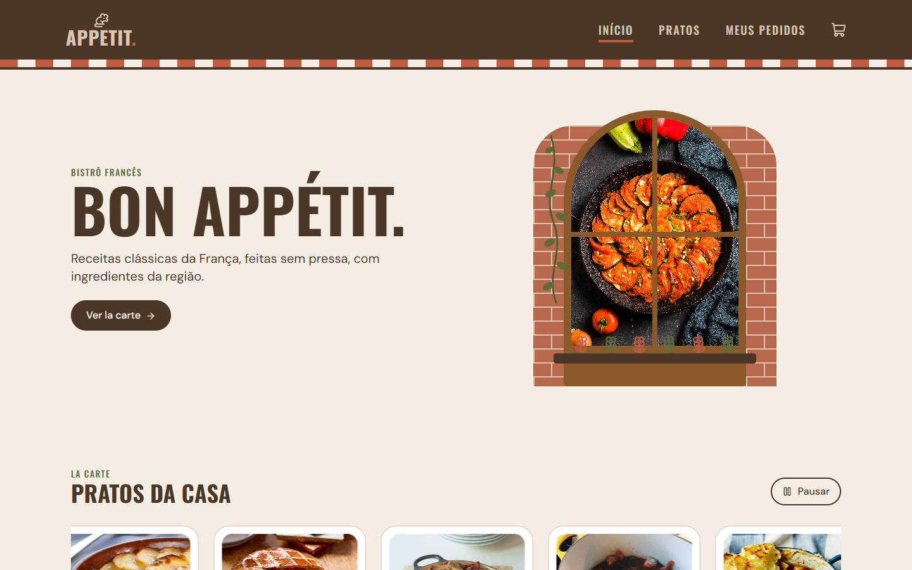
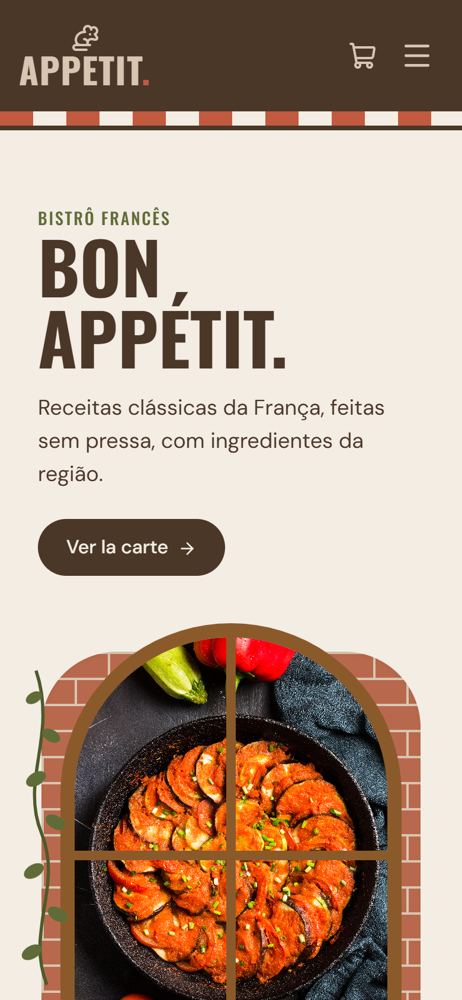
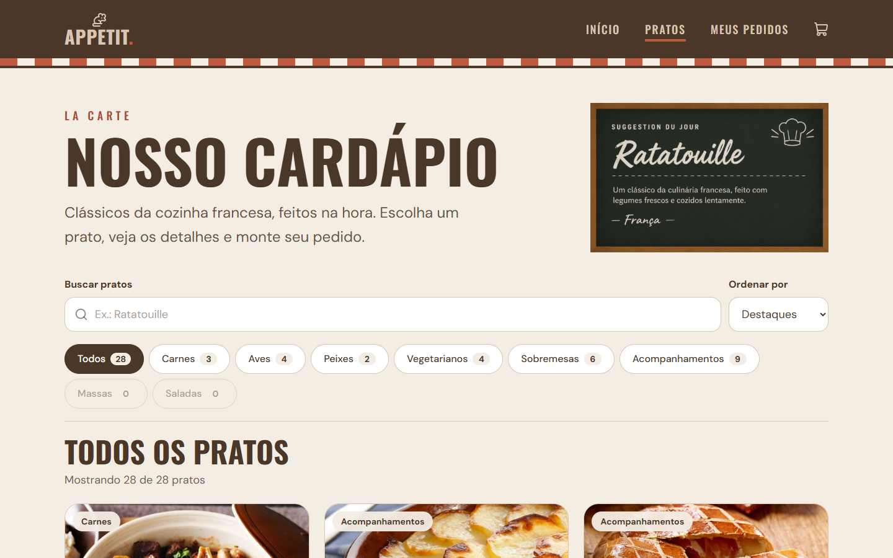
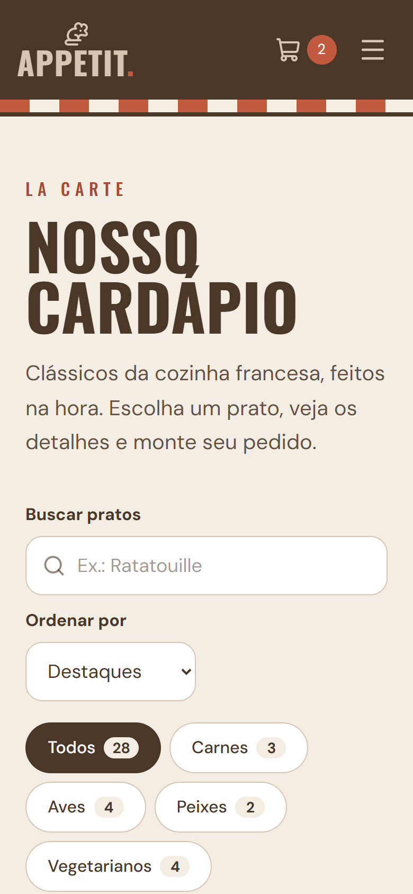
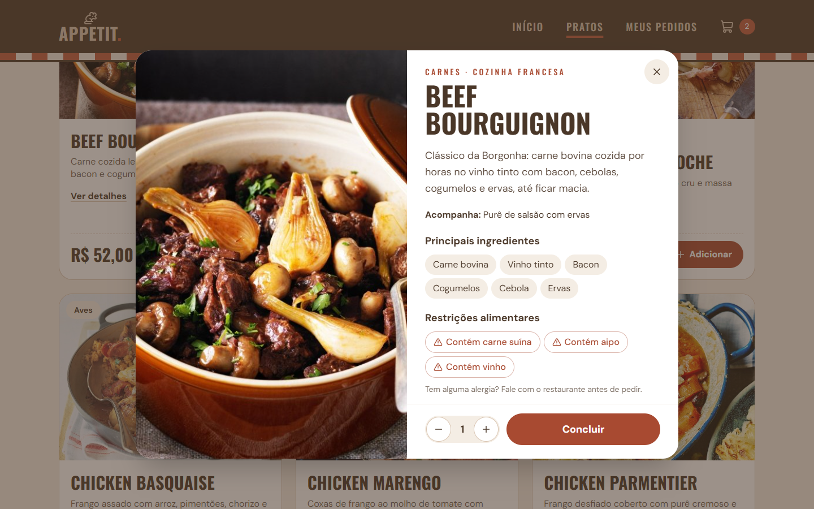
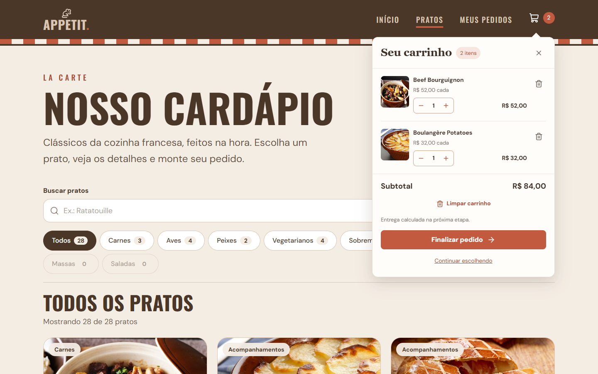
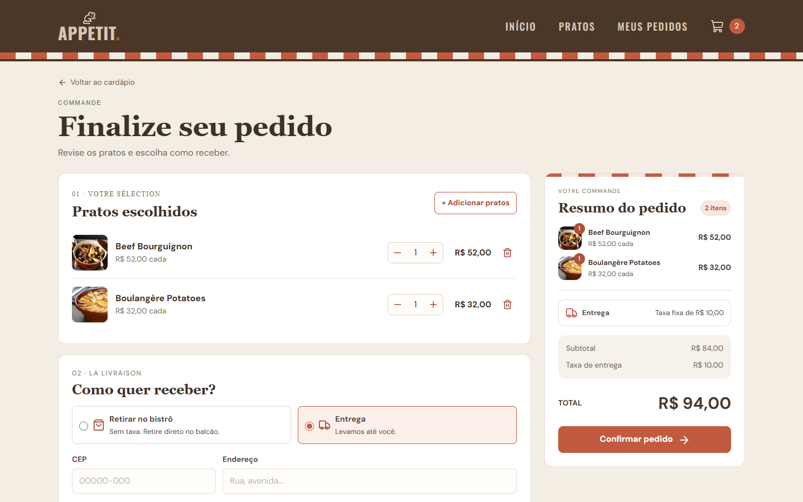
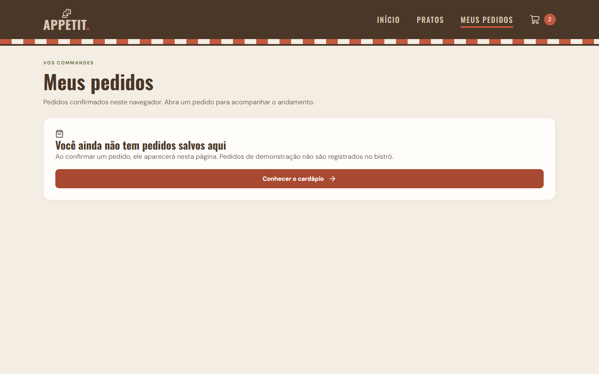

# Appetit · Bistrô francês

Site de um bistrô francês fictício, com cardápio online e pedidos. Projeto acadêmico da disciplina de Desenvolvimento Web, desenvolvido em grupo pela organização **fmcs**.

**Site no ar:** [appetit-liard.vercel.app](https://appetit-liard.vercel.app/)

---

## Sobre o projeto

O Appetit é um restaurante francês de clima rústico e aconchegante, no estilo dos bistrôs da Provence. O cliente acessa o site pelo celular ou pelo computador, conhece a casa, navega pelo cardápio e monta o pedido.

A identidade visual usa detalhes de bistrô em vez de símbolos óbvios: o toldo listrado da fachada, uma janela francesa com jardineira e expressões em francês nos títulos ("Bon appétit", "La carte").

## Páginas

| Página | O que tem | Status |
| --- | --- | --- |
| **Home** | Hero com janela francesa, carrossel "Pratos da casa" com pratos da API, seção "Nossa história" e rodapé | ✅ Pronta |
| **Pratos** | Cardápio completo, busca, filtro por categoria e modal com detalhes do prato | ✅ Pronta |
| **Pedidos** | Checkout com validação e envio ao backend | ✅ Integrado |
| **Meus pedidos** | Histórico neste navegador e acesso ao acompanhamento | ✅ Integrado |

## Telas

### Home

| Computador | Celular |
| --- | --- |
|  |  |

### Pratos

| Computador | Celular |
| --- | --- |
|  |  |

| Detalhes do prato | Carrinho no header |
| --- | --- |
|  |  |

### Pedido e Meus pedidos

| Finalizar pedido | Meus pedidos |
| --- | --- |
|  |  |

## Tecnologias

| Ferramenta | Uso |
| --- | --- |
| [React](https://react.dev) | Interface em componentes |
| [Vite](https://vite.dev) | Criação do projeto e servidor de desenvolvimento |
| [Tailwind CSS v4](https://tailwindcss.com) | Estilização com classes utilitárias |
| [React Router](https://reactrouter.com) | Navegação entre páginas sem recarregar |
| [Lucide](https://lucide.dev) | Ícones |
| [Spring Boot](https://spring.io/projects/spring-boot) + SQLite | Backend com o cardápio e os pedidos |
| [Render](https://render.com) | Publicação do backend |
| [TheMealDB](https://www.themealdb.com/api.php) | Origem dos pratos franceses e das fotos |
| [Vercel](https://vercel.com) | Publicação do site |

## Requisitos do trabalho

| Requisito | Como o projeto atende |
| --- | --- |
| 3 telas responsivas | Home, Pratos e Pedidos, com layout para celular e computador |
| 2 componentes reutilizáveis | `CardPrato` (Home e Pratos) e componentes de interface compartilhados |
| 3 interações | Menu mobile, pausa do carrossel, busca e filtro de pratos, modal de detalhes |
| Formulário com 5+ campos validados | Formulário da página Pedidos |
| 3 operações HTTP | `GET` de pratos e pedidos, `POST` de pedidos e `PATCH` de status na API Spring Boot |
| WCAG AA e Lighthouse acima de 90 | Home com **100** de acessibilidade no Lighthouse, no desktop e no mobile |
| Versionamento em grupo | Branches, commits semânticos e Pull Requests no GitHub |
| Publicação | Vercel |

## Identidade visual


| Cor | Hex | Uso |
| --- | --- | --- |
| Terracota | `#C25A3F` | Destaques: ponto do logo, link ativo, toldo |
| Bege Areia | `#D9C5B2` | Texto sobre o marrom (header e rodapé) |
| Bege Fendi | `#A39686` | Apoio |
| Verde Oliva | `#606C38` | Rótulos das seções |
| Madeira | `#8B5A2B` | Moldura da janela, hover dos botões |
| Marrom Escuro | `#4A3728` | Header, rodapé e texto principal |
| Creme | `#F4EDE4` | Fundo da página |

**Fontes:** [Oswald](https://fonts.google.com/specimen/Oswald) nos títulos e [DM Sans](https://fonts.google.com/specimen/DM+Sans) nos textos.

## Acessibilidade

- Contraste de cores conferido segundo a WCAG AA (4,5:1 para texto normal, 3:1 para texto grande)
- HTML semântico (`header`, `nav`, `main`, `section`, `footer`) e um único `h1` por página
- Navegação completa pelo teclado, com foco visível
- Textos alternativos nas imagens e `aria-hidden` nos elementos decorativos
- Animações desligadas no celular e para quem ativou "reduzir movimento" no sistema
- Botão para pausar o carrossel animado

## Como rodar o projeto

Pré-requisitos: [Node.js](https://nodejs.org) e Git instalados.

```bash
# 1. Clonar o repositório
git clone https://github.com/so-fmcs/appetit.git
cd appetit

# 2. Instalar as dependências
npm install

# 3. Rodar em modo de desenvolvimento
npm run dev
```

O site abre em `http://localhost:5173`.

Para gerar a versão de produção:

```bash
npm run build
npm run preview
```

## Estrutura de pastas

```
appetit/
├── backend/             # API Spring Boot (cardápio e pedidos)
├── public/              # imagens e favicon
├── screenshots/         # prints das telas usados neste README
├── tests/               # testes (npm test)
├── index.html           # título da página, fontes e idioma
├── vite.config.js       # plugins do React e do Tailwind, proxy da /api
├── vercel.json          # rotas da Vercel e encaminhamento da /api ao backend
└── src/
    ├── main.jsx         # ponto de entrada
    ├── App.jsx          # header, carrinho e rotas das páginas
    ├── index.css        # Tailwind, cores, fontes e classes próprias
    ├── pages/           # telas inteiras (Home, Pratos, Pedido, Meus pedidos...)
    ├── components/      # peças reutilizáveis (Header, Hero, CardPrato...)
    ├── services/        # chamadas à API (pratos e pedidos)
    ├── data/            # textos e dados fixos do restaurante
    ├── utils/           # funções auxiliares (cálculos, armazenamento)
    ├── context/         # contexto React do pedido
    └── assets/styles/   # CSS do carrinho, pedido, acompanhamento e pratos
```

## API e acompanhamento de pedidos

O frontend usa `/api` por padrão e não simula confirmações. O backend Spring Boot mantém o cardápio e os pedidos no SQLite. As imagens dos pratos são hospedadas pela TheMealDB; textos editoriais e avaliações da home continuam sendo conteúdo demonstrativo do restaurante fictício.

Inicie o backend em outro terminal, com o JDK 25 selecionado:

```bash
cd backend
export JAVA_HOME=$(/usr/libexec/java_home -v 25)
export PATH="$JAVA_HOME/bin:$PATH"
./mvnw spring-boot:run
```

Na raiz, rode `npm run dev`. O proxy do Vite encaminha `/api` para `http://localhost:8080`, inclusive no `npm run preview`. Reinicie o Vite depois de alterar a configuração. Em produção, o host deve encaminhar `/api` ao backend; alternativamente, configure `VITE_API_URL` e autorize essa origem no CORS do servidor. As variáveis `VITE_` são públicas e não devem conter senhas.

| Método | Rota | Uso |
| --- | --- | --- |
| GET | `/api/pratos` | Cardápio com preço e disponibilidade do banco |
| POST | `/api/pedidos` | Confirmação com ID gerado pelo servidor |
| GET | `/api/pedidos/{id}` | Dados, valores e status salvos |
| PATCH | `/api/pedidos/{id}/status` | Atualização do andamento no backend |

O carrinho salvo é sincronizado com o catálogo ao abrir o app e o checkout, atualizando preços e removendo pratos indisponíveis. A confirmação fica bloqueada enquanto a consulta do checkout não terminar; em caso de falha, é possível tentar novamente.

Após confirmar, acesse **Meus pedidos** no menu para reabrir o acompanhamento. O navegador guarda somente os IDs em `localStorage`; cada abertura consulta os detalhes no backend. O acompanhamento consulta novamente a cada 5 segundos até concluir ou cancelar. Em caso de falha, informa que os dados exibidos são da última consulta e permite tentar novamente.

Esse histórico pertence ao navegador atual, sem sincronização entre dispositivos. A URL `/pedido/{id}` também permite abrir um pedido existente diretamente. Pedidos antigos `SIM-...` não existem no banco. Referências reais da antiga sessão são recuperadas quando disponíveis. O status só muda quando atualizado no backend: a interface não inventa progresso nem previsão de entrega.

## Como contribuir (fluxo do grupo)

1. Atualizar a `main`: `git switch main` e `git pull`
2. Criar uma branch para a sua parte: `git switch -c feature/nome-da-parte`
3. Commitar em pedaços pequenos, com [commits semânticos](https://www.conventionalcommits.org) em inglês: `feat:`, `fix:`, `style:`, `chore:`, `refactor:`, `docs:`
4. Enviar a branch: `git push -u origin feature/nome-da-parte`
5. Abrir um Pull Request para a `main` e pedir a revisão de alguém do grupo

## Equipe

| Nome | GitHub |
| --- | --- |
| Ryan Alves | [@s3vla](https://github.com/s3vla) |
| Alexandre Wayss | [@alexandre-wayss](https://github.com/alexandre-wayss) |

## Créditos

- Dados dos pratos: [TheMealDB](https://www.themealdb.com)
- Fotos: [Unsplash](https://unsplash.com) e [Pexels](https://www.pexels.com)
- Ícones: [Lucide](https://lucide.dev)

Projeto acadêmico, sem fins comerciais. O restaurante, o endereço e as avaliações são fictícios.
