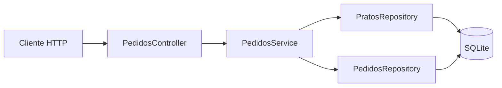

# API de pedidos

Este backend implementa o fluxo de pedidos do Appetit com Spring Boot, Spring Data JPA e SQLite. A API recebe e valida pedidos, salva os dados confirmados pelo cliente, consulta os detalhes e permite atualizar o status.

Todos os valores monetários são representados em centavos para evitar erros de arredondamento.

## O que foi implementado

- criação de pedidos com UUID e status inicial `CONFIRMADO`;
- validação dos dados do cliente, do recebimento e dos itens;
- consulta dos pratos no banco para confirmar existência, disponibilidade, nome e preço;
- cópia do nome e do preço unitário para o pedido, preservando o valor confirmado caso o cardápio mude;
- taxa de entrega salva no pedido, com valor padrão de `1000` centavos, e retirada sem taxa;
- persistência do cliente, endereço, itens, observações, datas e status em SQLite;
- consulta detalhada com subtotal, taxa de entrega e total calculados pelo servidor;
- atualização manual do status, respeitando a compatibilidade entre entrega e retirada.

## Como o código está organizado



- `PedidosController` define as rotas HTTP e os códigos de resposta.
- Os DTOs definem os contratos JSON de entrada e saída.
- `PedidosService` concentra validações, regras de negócio e cálculos.
- `PratosRepository` consulta o cardápio para validar os itens.
- `PedidosRepository` salva e consulta os pedidos.
- `Pedido` agrega `Cliente`, `Recebimento`, `Endereco` e uma coleção de `ItemPedido`.

## Endpoints

| Método | Rota | Resultado |
| --- | --- | --- |
| `POST` | `/api/pedidos` | Valida e salva um pedido; responde `201` com o ID |
| `GET` | `/api/pedidos/{id}` | Retorna os dados completos, o status e os totais |
| `PATCH` | `/api/pedidos/{id}/status` | Atualiza o status e retorna o ID e o novo status |

### Criar um pedido

```bash
curl -X POST http://localhost:8080/api/pedidos \
  -H 'Content-Type: application/json' \
  -d '{
    "cliente": {
      "nome": "Ana Silva",
      "telefone": "11999999999",
      "email": "ana@example.com"
    },
    "recebimento": {
      "tipo": "entrega",
      "endereco": {
        "cep": "01001000",
        "logradouro": "Rua das Flores",
        "numero": "123",
        "bairro": "Centro",
        "complemento": null
      }
    },
    "itens": [
      { "pratoId": "52904", "quantidade": 2 }
    ],
    "observacoes": "Sem cebola"
  }'
```

Resposta (`201 Created`):

```json
{
  "id": "7e9d0f13-68cb-4ad8-b43b-e86be16c4771"
}
```

Para retirada, use `"tipo": "retirada"` e `"endereco": null`.

### Consultar um pedido

```bash
curl http://localhost:8080/api/pedidos/{id}
```

A resposta contém:

- ID, status e data de criação;
- dados do cliente e do recebimento;
- itens com nome, quantidade, preço unitário e imagem;
- observações;
- `subtotalCentavos`, `taxaEntregaCentavos` e `totalCentavos`.

O nome e o preço são os valores registrados quando o pedido foi criado. A imagem é consultada no cadastro atual do prato.

### Atualizar o status

```bash
curl -X PATCH http://localhost:8080/api/pedidos/{id}/status \
  -H 'Content-Type: application/json' \
  -d '{ "status": "EM_PREPARO" }'
```

Status aceitos:

- `CONFIRMADO`;
- `EM_PREPARO`;
- `PRONTO_PARA_RETIRADA`;
- `SAIU_PARA_ENTREGA`;
- `CONCLUIDO`;
- `CANCELADO`.

`PRONTO_PARA_RETIRADA` só é compatível com retirada, enquanto `SAIU_PARA_ENTREGA` só é compatível com entrega. A API não impõe uma ordem entre os demais status e não faz o avanço automático.

## Validações e respostas de erro

- nome com pelo menos três caracteres e uma letra;
- telefone com DDD e 10 ou 11 dígitos;
- e-mail opcional, mas validado quando informado;
- endereço obrigatório para entrega e CEP com oito dígitos;
- pelo menos um item, com quantidade positiva e sem pratos repetidos;
- prato existente e disponível;
- observações opcionais com até 1.000 caracteres.

| Código | Situação |
| --- | --- |
| `400 Bad Request` | Dados ausentes ou inválidos |
| `404 Not Found` | Pedido ou prato inexistente |
| `409 Conflict` | Prato indisponível ou status incompatível com o recebimento |

## Como executar

Pré-requisito: Java 25 ou superior.

```bash
cd backend
./mvnw spring-boot:run
```

A API usa `http://localhost:8080` por padrão. O SQLite grava em `appetit.db`; outro caminho pode ser definido com a variável `APPETIT_DB_PATH`.

A taxa de entrega é configurada por `appetit.taxa-entrega-centavos` em `application.properties`.

O frontend usa `/api` e o proxy do Vite encaminha as chamadas para `http://localhost:8080` no desenvolvimento e no preview. Em produção, configure esse encaminhamento no host ou autorize a origem do frontend no CORS do backend se usar uma URL separada.

## Testes

```bash
cd backend
./mvnw test
```

A suíte atual executa seis testes e cobre:

- inicialização da aplicação;
- carga dos 28 pratos no SQLite;
- endpoints de consulta do cardápio;
- persistência e leitura de um pedido;
- contrato JSON enviado pelo frontend;
- serialização da resposta com o ID criado.

Os testes atuais não exercitam diretamente os endpoints de pedidos (`POST`, `GET` e `PATCH`) nem todas as falhas de validação via HTTP.

## Explicação em 2 minutos

> Este commit adiciona ao Appetit uma API real de pedidos em Java com Spring Boot, JPA e SQLite. Antes, o frontend apenas simulava o envio. Agora o backend consegue receber um pedido, validar os dados, salvá-lo e devolver um identificador único.
>
> O fluxo começa no endpoint POST `/api/pedidos`. Ele recebe os dados do cliente, a opção de entrega ou retirada, os itens e as observações. A camada de serviço verifica nome, telefone e e-mail, exige endereço e CEP quando for entrega e garante que exista pelo menos um item, com quantidade positiva e sem pratos repetidos.
>
> Um cuidado importante é que o backend não aceita nome ou preço enviados pelo navegador. Ele procura cada prato no banco, confirma que está disponível e usa o preço cadastrado no servidor. O nome e o preço são copiados para o pedido. Assim, o valor confirmado continua o mesmo mesmo que o cardápio mude depois. Para entrega, a taxa configurada também é salva; para retirada, ela fica zerada.
>
> Em seguida, o pedido é persistido com um UUID, a data de criação e o status inicial `CONFIRMADO`. O endpoint GET `/api/pedidos/{id}` devolve os detalhes e calcula subtotal, taxa e total em centavos, evitando problemas de arredondamento. Já o PATCH `/api/pedidos/{id}/status` atualiza o andamento e impede, por exemplo, usar `SAIU_PARA_ENTREGA` em uma retirada ou `PRONTO_PARA_RETIRADA` em uma entrega.
>
> A implementação foi separada em controller, DTOs, service, entidades e repositories. Por fim, seis testes verificam a inicialização, o banco SQLite, o cardápio, a persistência e o contrato JSON esperado pelo frontend.
